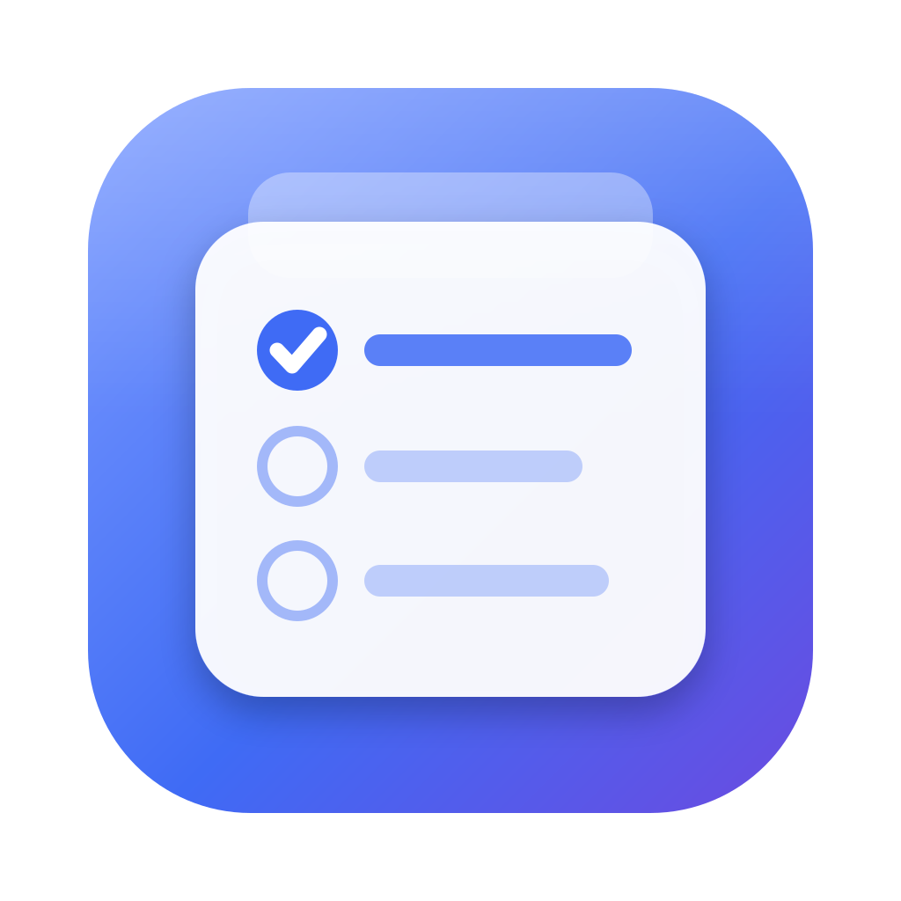

<p align="center">
  
</p>

<h1 align="center">TaskPilot</h1>

<p align="center">
  <strong>写下需求，AI 团队拆成工作包、盯住质量。<br />代码你来写，或交给 Coding Agent，最后由你点头提交。</strong>
</p>

<p align="center">
  <a href="https://github.com/Erinable/TaskPilot/actions/workflows/ci.yml"></a>
  
</p>

> [!NOTE]
> 早期预览：只支持 macOS。安装包可从 [GitHub Releases](https://github.com/Erinable/TaskPilot/releases) 下载；使用无需开发者账号的 ad-hoc 临时签名，没有 Apple 公证。安装、校验与手工更新见[分发说明](docs/distribution.md)。

## 它是什么

TaskPilot 是一个桌面应用，在 Claude Code、Codex 这类 CLI 外面加一层流程：谁来澄清需求、怎么拆、改哪些文件、怎么算做完、谁来检查。模型调用仍由你本机装好的 CLI 发出。

它有两种用法：

- 做项目：AI 团队把需求拆成工作包，你自己写或交给 Coding Agent，检查和 QA 通过后由你提交。
- 学编程：AI 出 lab 和练习，你自己写，Tutor 给提示、判卷、讲参考答案，掌握度和笔记帮你复习。

## 一个需求怎么走完

1. 写需求：在「需求中心」用大白话描述。Architect 读相关代码写成接口摘要，Product Lead 据此提问。
2. 拆分：Product Lead 拆成工作包，每个包带文件范围、步骤、验收条件和依赖，你审阅后发布。
3. 执行：领取时记录基线。你照步骤写，或让 Coding Agent 在隔离副本里产出补丁，你逐个文件确认后应用。
4. 审查：TaskPilot 先跑你配置的检查，和基线对比，只有新引入的失败才算数；QA 再对照验收条件审查。
5. 提交：只提交该包文件范围内的改动，只在本机，从不推送。

计划和代码对不上时可以「报告偏差」，由 Architect 裁决或重新规划。

## 功能

做项目

- 工作队列：看板或列表，前置包没完成不能领取。
- 检查步骤：`setup / build / format / lint / typecheck / test / coverage` 和自定义步骤。仓库里的 `taskpilot.toml` 可以选 TypeScript、Rust、Python 预设，本机可以覆盖。命令直接运行，不经过 shell。
- Coding Agent：在隔离副本里改代码；你在 AI 写代码时改过的文件会先预演三方合并，冲突按文件由你选。检查失败或 QA 驳回会自动重试，最多 3 轮。
- 环境管家：读项目推荐安装方式和脚本，每一步等你点击，默认 `--ignore-scripts`。
- 发布：Release Manager 起草版本号、更新说明和检查清单，打 tag、推送等动作留给你。
- 工程地图、活动记录、成本统计（只统计，不限额）、多仓库切换、`⌘K` 搜索。

学编程

- 课程包：内置「编程」和「操作系统」两个，也可以导入、复制、编辑，或让 Tutor 根据你的目标起草。非内置的课程包要你确认内容后才使用。
- 「我想学…」：选水平、目标、lab 工具链（C、Rust 或 Python 3）和每周时间，Tutor 规划学习路径，按路径生成 lab。生成前会在沙箱里检查工具链是否装好，缺什么就给出安装命令。每个 lab 在沙箱里自检：参考解通过全部测试、初始代码不通过、变异体能被测试抓到。
- 练习：先交卷再看参考答案。Tutor 按课程包的评分标准判卷，给出质量分和独立度分；提示分 L1 到 L5 逐级打开。
- 笔记：一个 Markdown 文件夹，可以直接用 Obsidian 的库，支持 `[[双链]]` 和 `#标签`。判卷意见一键存成笔记。
- 掌握度：按概念显示学习状态，带概念的笔记按 1/3/7/14/30 天间隔复习。

AI 团队

| 成员 | 做什么 | 能看到什么 |
| --- | --- | --- |
| Architect | 写接口摘要，裁决偏差 | 已提交的代码 |
| Product Lead | 澄清需求，拆工作包 | 摘要和文件列表，不看源码 |
| QA | 审查改动 | diff 和检查结果 |
| Coding Agent | 写补丁 | 隔离副本，可读写、可执行 |
| Tutor | 讲解步骤、给提示、判卷、规划学习路径、生成 lab | 工作包范围内已提交的代码 |
| Release Manager | 起草发布 | 提交标题和改动路径，不含内容 |
| Environment Steward | 推荐环境配置 | 清单、锁文件和 CI 配置 |

每个成员可以单独选 CLI（Claude Code、Pi、Grok、Codex、OpenCode）、模型和思考强度，Codex 可用于全部角色。规划与审查角色会检查所选 CLI 的受限分析能力，并继续校验结构化输出。QA 的结论由 TaskPilot 复核：阻塞检查失败或关联测试没通过，模型怎么说都驳回。

## 快速开始

需要 macOS、git、Node.js 22.18 或更高版本，以及已安装并登录的所选 CLI。分析类角色默认使用 Claude Code，例如：

```bash
npm install -g @anthropic-ai/claude-code
claude   # 运行一次完成登录
```

也可以安装并登录 Codex，在「设置 → 模型与智能体」将规划、审查、导师及编码角色分别切换为 Codex。Coding Agent 默认使用 Codex；角色可共用已登录的 CLI，不必为每个角色另装一份。TaskPilot 不保存 API Key，认证由各 CLI 自己管理。

从源码运行：

```bash
git clone https://github.com/Erinable/TaskPilot.git
cd TaskPilot
npm install
npm run dev
```

`npm run dev` 和 `npm start` 会检查 Electron 二进制，并在启动时清除继承的 `ELECTRON_RUN_AS_NODE`。如果直接运行 `electron-vite` 遇到 `electron does not provide an export named 'BrowserWindow'`，先执行 `unset ELECTRON_RUN_AS_NODE`，再重试。

打包成 App：`npm run dist`，在 `dist/` 生成本机架构的 dmg 和 zip；传入 `-- --arm64` 或 `-- --x64` 指定架构，`-- --arm64 --x64` 同时生成两种。运行 `npm run dist:checksums` 生成 SHA-256 清单。DMG 本身不需要付费 Apple 开发者账号，当前安装包没有 Developer ID 签名或公证。首次打开请按[分发说明](docs/distribution.md)中的 macOS「隐私与安全 → 仍要打开」步骤操作；更新前先备份本地数据与外部笔记。

打开后，首页的「开始使用」先选择「做项目」或「学编程」。项目路径会检查所选 CLI、项目仓库和有效检查步骤；学习路径检查 Tutor 后直接进入学习目标访谈。

> [!TIP]
> 新安装默认自动检测 CLI 与本机 Node.js。旧版从 Finder 启动找不到命令时，到「设置 → 运行环境」切换为「自动检测」并保存；自定义安装可选择可执行文件或添加命令目录。登录 shell 超时时也会补充已发现的本机工具。

## 安全边界

能不让 AI 碰的就不让它碰，必须碰的放进隔离环境，最后一步由人确认。

- 分析类角色（除 Coding Agent 外都是）运行在无工具模式：不执行命令、不读工作区外的文件、不连 MCP。它们看到的代码只来自 git 已跟踪的文件，疑似密钥的路径一律跳过。
- Coding Agent 默认运行在 macOS Seatbelt 沙箱里，只在基线副本上工作，读不到你真实的 CLI 配置目录、`~/.ssh` 等敏感位置。需要更严的隔离可以用独立系统账号模式。
- 模型输出在使用前都会校验，界面一律按纯文本显示。

沙箱可以联网，也能读到 CLI 的登录凭据。补丁应用后，你配置的检查命令以你自己的权限运行。完整设计和已接受的风险见[安全边界与部署说明](docs/coding-agent-security.md)。

## 数据与隐私

- 数据在 `~/Library/Application Support/taskpilot`：全局偏好、笔记、掌握度，以及每个仓库在 `repos/<id>/` 下的需求、工作包和活动记录。
- 「设置 → 数据」可创建带 SHA-256 清单的备份、预览并准备恢复、复制诊断信息或打开日志目录。恢复在重启时执行并保留原数据；应用无法启动时，也可在错误页选择备份。外部笔记库和项目源代码需单独备份，详见[恢复与更新说明](docs/distribution.md)。
- 未提交的需求、访谈回答和课程编辑草稿保存在本机，重新打开相应表单后可恢复或丢弃；正式内容已更新的旧草稿不会覆盖新内容。
- 只有这些操作会改你的仓库：应用补丁、本机提交、把更新说明写进你指定的 `.md` 文件、创建 lab 仓库，以及你点击运行的环境步骤和检查命令。
- TaskPilot 自己只在一处联网：成本页点「同步价格」时下载 [models.dev](https://models.dev) 的价格表。没有遥测，也没有自动更新。
- 统计的日界默认按 `Asia/Shanghai` 划分，可以用环境变量 `TASKPILOT_TIME_ZONE` 改。

## 参与开发

技术栈：Electron + electron-vite，主进程用 TypeScript，界面用 Vue 3、Pinia、Element Plus、UnoCSS，测试用 Vitest。目录结构、模块边界、测试规则和代码风格都在 [AGENTS.md](AGENTS.md)。

```bash
npm run dev          # 开发模式，带热更新
npm test             # 全部测试
npm run test:fast    # 跳过调用 uv、cargo、make 的端到端测试
npm run test:e2e     # 只跑端到端测试
npm run typecheck
npm run lint
npm run format:check
npm run build
```

CI 在 Ubuntu 和 macOS 上并行跑三类 job：类型检查、lint、格式和构建；`test:fast`；`test:e2e`。另外检查 `src` 和 `tests` 的重复代码（阈值 1%）、新增的函数复杂度和循环依赖。本地可以用 `npm run analyze:duplicates`、`npm run check:complexity`、`npm run analyze:cycles` 单独跑。

改了某个 AI 角色的提示词，用对应的评测检查有没有变差：`npm run eval:product-lead`、`eval:qa`、`eval:architect`、`eval:tutor-grade`、`eval:lab-gen`、`eval:hint-leak`。评测调用真实模型，会产生费用，用法见各 `evals/*/README.md`。

提交信息用 Conventional Commits，行为改动要附回归测试，PR 里写明验证命令和结果。
