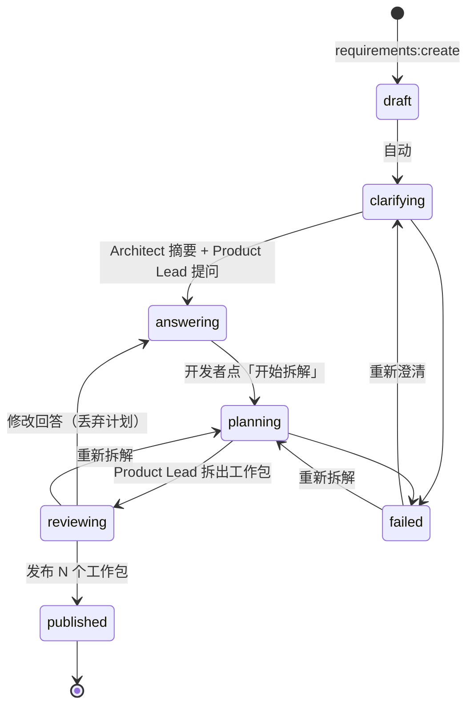
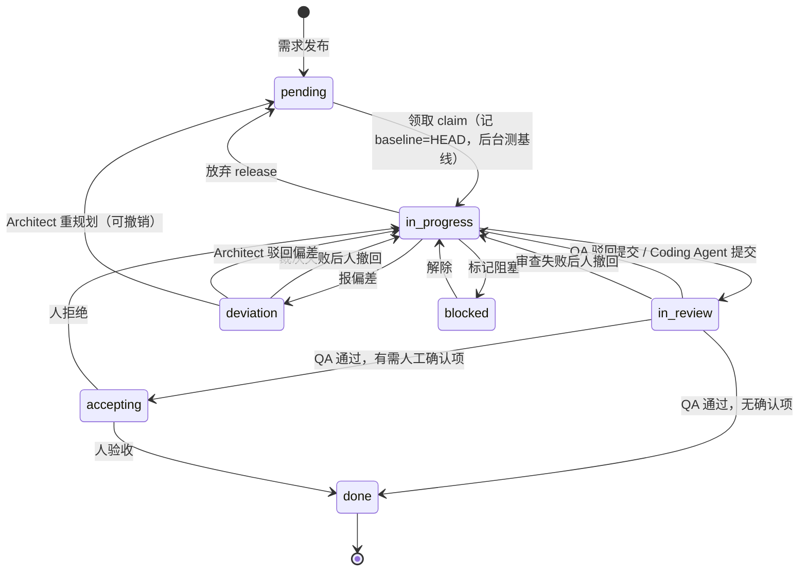
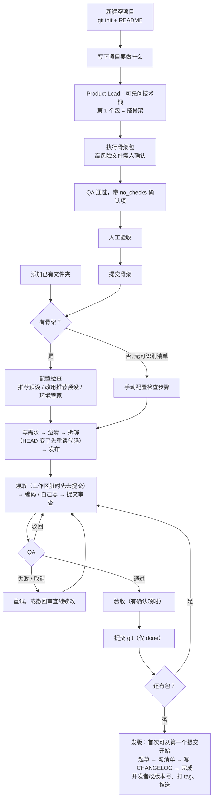

# 项目开发流程梳理：从引入 / 新建项目到发版

本文写于 2026-11-10，环境管家的基础设施配置流程更新于 2026-11-11。第 5 节列出的问题已在同一批改动里修复，第 3–6 节描述修复后的行为。所有结论来自读代码，标了文件和行号；标「推断」的没有实际运行验证。课程（`kind: 'course'`）流程不在本文范围内。

## 1. 参与者和边界

| 角色 | 什么时候运行 | 输入 | 输出 / 能做的事 | 不能做的事 |
|---|---|---|---|---|
| 开发者 | 全程 | — | 写需求、回答问题、发布计划、领取、自己写代码、提交审查、报偏差、验收、提交 git、完成发版 | — |
| Architect | ① 需求澄清时，在 Product Lead 之前；拆解前 HEAD 变了再读一次；② 开发者报偏差后裁决 | 已跟踪文件列表（≤400）、自选 ≤12 个文件的内容（经 `repo_reader.ts`） | 模块接口摘要（记下 HEAD）；裁决「驳回 / 重规划」 | 写代码 |
| Product Lead | 澄清（提问 ≤5）、拆解（≤6 个包）、单包重做 | 需求、回答、文件列表、Architect 摘要，**不看源码** | 工作包：步骤、fileScope、验收标准、依赖 | 读代码 |
| Environment Steward | 开发者在「环境初始化」页点规划时（空项目返回 `no_skeleton`，不调用） | `typescript_setup.ts` 探测的事实 | 安装与已有检查脚本；缺失基础设施的配置工作包提案，经人确认加入队列 | 直接写命令或配置；目前自动规划只支持 npm 项目 |
| Coding Agent | 开发者在执行页点开始（AI 模式；自己写的包先「改为交给 Coding Agent」）；检查失败或 QA 驳回后自动续轮，共 3 轮 | 基线快照的隔离副本、包定义、提交前检查命令 | 补丁；检查通过后自己触发 `coding_submitted` | 改高风险路径（`package.json`、`tests/`、`taskpilot.toml`…）需人确认；practice、self 模式不能用 |
| QA | 每次提交审查后自动 | diff（`review_diff.ts`）、检查结果与基线对比、验收标准 | 通过 / 驳回；通过且无「需人工确认」项直接 done | 推翻 TaskPilot 自己的证据（只能更严） |
| Tutor | 执行中某步骤点「讲解」（L1–L5 逐级）；practice 模式判卷 | fileScope 内**已提交**的文件 ≤6 个 | 讲解、提示、评分 | 读未提交文件 |
| Release Manager | 开发者在发版页点生成 | 起点..HEAD 的提交标题、改动路径（无内容）、未发布的 done 包 | 版本号建议、发版说明、检查清单；把说明写进开发者指定的 `.md` | 打 tag、提交、推送、改版本文件 |

所有后台运行都登记在 `background_runs.ts`，切换 / 移除当前仓库时全部取消（[app_context.ts](../src/main/app/app_context.ts) `switchRepository`）。

## 2. 四个状态机

### 2.1 需求（[requirement_store.ts:32](../src/main/requirements/requirement_store.ts#L32)）

`published` 是终态，不能删除、不能撤回。

### 2.2 工作包（[work_package_status.ts:58-76](../src/main/work_packages/work_package_status.ts#L58-L76)）

- 领取要求依赖包都已 done 或被豁免（[app_context.ts:356-369](../src/main/app/app_context.ts#L356-L369)）。
- 领取要求仓库有 HEAD（`baseline_required`）。
- 审查或裁决失败 / 被取消后，开发者可以撤回（`withdraw_review` / `withdraw_deviation`）回到执行中。

### 2.3 Coding Agent 一轮（[coding_types.ts:22-23](../src/shared/coding_types.ts#L22-L23)）

`preparing → running → checking → ready →（人审阅补丁 / 自动轮直接）applying → verifying → submitted`

- 自动轮遇到高风险文件、和开发者改动冲突、无改动、超时时停下，等人处理。基础设施配置包改到依赖清单/锁文件时，应用后另停在 `applied + setup_required`，等本机安装后再继续检查。
- 自动轮没有改动时，先记录 `discarded + no_changes` 再清理副本，不会把“可读补丁”暴露给界面。补丁读取绑定具体轮次，自动应用中不抢读，迟到的结果或错误不影响下一轮。应用或丢弃后的改动看本机 diff / 历史，不再读已清理副本。
- 提交前检查失败或 QA 驳回时，带着失败信息自动开下一轮，最多 3 轮（[coding_loop.ts:16](../src/main/coding/coding_loop.ts#L16)）。

### 2.4 发版草稿（[release_store.ts:3-5](../src/main/release/release_store.ts#L3-L5)）

`generating → ready | failed`；`ready` 里清单全勾后「完成发布」，写入历史并清空草稿。完成发布只是本地记账，不打 tag。

## 3. 场景 A：引入已有项目

以根目录有 `package.json` 的 Node 项目为例；Rust / Python 的差异在 A2 注明。

**A1 添加项目。** 侧栏「添加项目 → 打开已有文件夹」，必须在 git 仓库内，子目录会归一到仓库根（`validateRoot`）。第一个仓库会直接打开，之后添加的只列出来，点它才切换。

**A2 配置检查（引导清单标为必需，后端不强制）。** 可以直接使用已有检查，也可以让环境管家补齐配置：
1. 设置 → 检查步骤 →「用推荐预设创建」，写 `taskpilot.toml`（`preset = "typescript"` / `rust` / `python`），预设把已有脚本映射成 build / lint / test…。只有 `test` 默认是「提交时、阻塞」。
2. 环境初始化页 → Environment Steward 分析依赖、已有配置和本机工具 → 开发者逐步运行 install / rebuild，并可选择把已有 test / lint / build / typecheck / format / coverage 脚本写进本机检查配置。
3. 检查或工具配置缺失时，环境管家同时展示「基础设施配置」提案：需要的检查、实施步骤、文件范围和验收条件。开发者点「生成配置工作包」，工作包进入正常队列，领取并交给 Coding Agent 实施；高风险文件仍需确认，之后经过 QA、验收和提交。不是所有项目都适合 build 或覆盖率，环境管家按事实决定。

配置包若改了依赖清单或锁文件，应用后停在 `setup_required`：先在本机安装依赖，再点「依赖已安装，继续检查」接上检查和 QA。完成后环境页提示先保存到 git，再显式重新分析读取新脚本；由配置包写入的项目检查自动生效，本机自定义优先级不变。重复点击复用已有工作包；仓库提交或暂存内容变化后，旧计划不能继续运行或生成包。Rust / Python 仓库的自动环境规划仍是 `setup_unsupported`，可以使用语言预设手动设置检查。

**A3 写需求。** 需求中心「我想做…」→ Architect 读代码出摘要 → Product Lead 提问（0–5 个）→ 开发者回答或用推荐做法 →「开始拆解」→ 审阅计划（可单包重做 / 重新拆解）→ 发布。仓库有提交阶段的 test 检查时，每个包的验收标准都会关联测试名。

**A4 执行一个工作包。**
1. 领取，选模式：AI（Coding Agent 写）/ 自己写（需要时点「改为交给 Coding Agent」）/ 练习（practice，自己写，后台生成参考答案，判卷）。工作区有未提交改动时，领取前会查询已完成包的当前提交预览，只有确实能提交文件的包才提供「先去提交」入口；都不能处理时说明要在 Git 工具或终端处理。
2. 领取时记 baseline = HEAD，在**干净工作区**上后台跑一遍提交检查作为基线；工作区脏时基线记为 `dirty_tree`，之后的失败都不能和基线比。
3. 写代码：AI 模式下 Coding Agent 在隔离副本里改，人审阅补丁后应用（自动续轮直接应用），跑提交前检查，通过后自己提交审查；自己写时随时可以点步骤上的 Tutor 讲解。
4. 包含根目录 `package.json` 的工作包会自动带上仓库已存在的普通 npm 锁文件（`package-lock.json` / `npm-shrinkwrap.json`），使依赖清单和锁文件能在同一轮同步。旧计划也适用；范围显示、编码提示、快照、补丁、审查和提交一致，锁文件仍需高风险确认，不扩展其他业务文件。
5. 和计划对不上时报偏差，Architect 裁决：驳回则继续写，重规划则包回到 pending（开发者可以撤销重规划）。

**A5 审查和验收。** QA 结合检查证据、基线对比和验收标准判定。阻塞检查失败或关联测试失败 / 缺失时直接驳回，不调用模型。通过后有「需人工确认」项（一项检查都没运行、检查不可验证、基线已有失败、手动验收标准…）就停在待验收，否则直接 done。审查失败或取消时可以重试，也可以撤回继续改。

待验收页先展示交付摘要和合并后的验收确认项：逐项区分关联测试证据、QA 代码判断和人工确认，实际验证后勾选，再点「确认并验收」；有问题可直接「打回修改」。勾选只属于本次页面中的审查，换包或审查证据改变会重置，最终人工决定沿用已有验收状态保存。原计划、文件范围、编码历史、手动复查与 diff 默认收起，使用页面统一滚动；待验收不能直接重新编码，打回执行中后才可重试。AI 模式显示原计划步骤数，不把人工未勾选当作实现进度。没有解析到测试用例数量时明确显示“数量未解析”；手动复查和带时间的历史自动检查分开显示，不把历史通过当成当前工作树的结果。

**A6 提交 git。** 包 done 后，执行页提供「提交」：提交 fileScope 内的改动，并可勾选附带提交 `taskpilot.toml`。包的 fileScope 包含根目录 `package.json` 时，已存在的普通 npm 锁文件纳入有效文件范围，可一并提交，即使其他文件已经提交，也能单独保存锁文件；其他范围外文件、疑似密钥和重命名留给开发者。TaskPilot 不推送、不切分支、不 amend。

执行页「改动」展示相对领取基线的差异，包含已提交的历史改动；当前尚未提交的文件以「保存到 git」中的实时列表为准。提交后可点「重新检查未提交文件」继续保存后续生成的配置 / 锁文件。

**A7 发版。** 发版页：起点是上次「完成发布」的提交，或最近的 tag，都没有时让开发者从「项目的第一个提交」或最近 30 个提交里选。版本号以清单文件和上次发布中较新的为基础。Release Manager 起草版本号、说明和清单 → 开发者编辑、逐项勾选 → 可选把说明写进 `CHANGELOG.md` →「完成发布」。改版本文件、提交、打 tag、推送都由开发者自己做。

## 4. 场景 B：新建项目

「空项目」的判定在 [blank_project.ts](../src/shared/blank_project.ts)：已跟踪文件只有 README、许可证、`.gitignore` 这类文件、Markdown 笔记和 `taskpilot.toml`。主进程和渲染进程共用这条规则（`WorkspaceView.blank`）。

**B1 新建。** 侧栏「添加项目 → 新建空项目」，选空文件夹。TaskPilot `git init`，提交 `README.md` 和 `.gitignore`，打开它。

**B2 写下项目要做什么。** 引导清单认出空项目：「写下项目要做什么」排在前面；「骨架提交后设置自动检查」变成可选、等待中，不挡清单。这时去环境初始化页，环境管家返回 `no_skeleton`，以提示而不是错误显示「先写需求，第一个工作包会搭好骨架」，不调用模型。

**B3 澄清和拆解。** Architect 照常运行（只有 README 可读）。Product Lead 看到空仓库：
- 澄清时，需求没说技术栈且会影响计划，就先问，并给出推荐做法；
- 拆解时，第 1 个包只搭骨架（技术栈、清单文件、源码和测试目录、一个能跑通的示例测试、`.gitignore`），其余包都依赖它；第 1 个包的验收标准不关联测试。

**B4 执行骨架包。** 能领取（有初始提交）。`package.json`、`tests/` 等是 Coding Agent 的高风险路径，应用补丁时需要人确认。基线测量是 `no_checks`。

**B5 审查。** 没有运行任何检查时，QA 通过也会带上 `no_checks` 确认项，停在「待验收」，由人运行一下确认后验收。

**B6 提交骨架，配置检查。** 包 done 后提交 git；提交会刷新工作区状态，引导清单和检查步骤页随之认出项目语言：
- 还没有 `taskpilot.toml`：「用推荐预设创建」；
- 已经写过 `preset = "none"`：「改用推荐预设」，只改 `preset` 这一行。

本机还没有依赖目录时，「下一步」先引导去环境初始化安装。若缺少类型检查、lint、格式检查等基础设施，可在这里审阅环境管家方案并生成配置工作包，然后进入场景 A 的 A3 起的流程。下一个需求（或这个需求重新拆解）会让 Architect 重新读代码，因为 HEAD 变了。

**B7 首次发版。** 起点选择里第一项是「从项目的第一个提交开始（首次发版）」，范围包含初始提交。版本号从 0.0.0 起算。

## 5. 问题和修复

| # | 问题 | 修复 |
|---|---|---|
| 1 | 空项目的「配置检查」排在「写需求」前面且必需 | 空项目时「写需求」在前；检查步骤可选、等待骨架（[onboarding.ts](../src/renderer/src/lib/onboarding.ts)） |
| 2 | Product Lead 没有「空仓库先搭骨架」的规则 | 空仓库时澄清可问技术栈，拆解第 1 个包搭骨架（[product_lead.ts](../src/main/agents/product_lead.ts) `BLANK_CLARIFY` / `BLANK_PLAN`）。**prompt 改动尚未跑 `npm run eval:product-lead`** |
| 3 | `preset = "none"` 不会随骨架升级 | `workspace:set-project-preset` 只改 preset 一行；检查步骤页「改用推荐预设」（[project_config.ts](../src/main/repository/project_config.ts) `setPreset`） |
| 4 | 环境管家对空项目说「只支持 Node 项目」 | 新 blocker `no_skeleton`，以提示显示，不调用模型（[ipc/environment.ts](../src/main/ipc/environment.ts)） |
| 5 | QA 自动 done 后没提交，下一个包基线是 `dirty_tree` | 领取时工作区脏，查询当前提交预览，仅为确实有可提交文件的已完成包提供「先去提交」入口（[execution_actions.ts](../src/renderer/src/stores/execution_actions.ts)） |
| 6 | 「待验收」就能提交 git | 只有 `done` 能提交（[ipc/commit.ts](../src/main/ipc/commit.ts)） |
| 7 | 没有检查时 QA 通过即 done，无人复核 | 没有任何检查运行时加 `no_checks` 确认项，停在待验收（[evidence.ts](../src/main/checking/evidence.ts) `attention`） |
| 8 | 首次发版不能包含初始提交 | 起点可选 `root`，用空树作起点（[git.ts](../src/main/repository/git.ts) `EMPTY_TREE`） |
| 9 | 超过 50 个完成包时静默截断，被截的包下次还会出现 | 全部包都记为已发布；prompt 只描述前 50 个并写明省略了多少（[release_manager.ts](../src/main/agents/release_manager.ts) `MAX_PROMPT_PACKAGES`） |
| 10 | 版本文件没改时下次算出同一个版本号 | 以清单版本和上次发布版本中较新的为当前版本（[pipeline.ts](../src/main/agents/pipeline.ts) `collectReleaseInput`） |
| 11 | QA / Architect 失败或取消后，包只能重试 | 新的人工流转 `withdraw_review`、`withdraw_deviation`，只在审查 / 裁决已失败时可用（[work_package_status.ts](../src/main/work_packages/work_package_status.ts)） |
| 12 | 拆解用的 Architect 摘要可能已过时 | 摘要记下读代码时的 HEAD，拆解前 HEAD 变了就重新读；Product Lead 失败时 Architect 的花费也计入需求（[requirement_service.ts](../src/main/requirements/requirement_service.ts)） |
| 13 | 「自己写」模式仍显示 Coding Agent，后端也不拦 | 「自己写」不显示 Coding Agent 面板，提供「改为交给 Coding Agent」（`package:hand-to-ai`，模式改为 ai）；后端对 self 模式返回 `self_mode` |
| 14 | 死代码：包的 `clarifying`、`breakdown_done`、`onPackagesPublished` | 已删除；旧活动日志里的未知流转显示为「更新了工作包状态」 |
| 15 | 停在 `draft` 的需求没有出口 | 详情页显示「开始澄清」 |

`done` 仍是终态，没有加「重新打开」：已完成的包要改，新建一个需求即可，这样历史和发版记录不会被改写。

子代理报告中提到但核对后不成立的一条：「没有检查时关联测试的验收标准必然被驳回」。没有提交阶段 test 检查时 `linkTests` 为假，Product Lead 不会写 `test`（[product_lead.ts](../src/main/agents/product_lead.ts)），所以不会出现这种组合；只有检查后来被删掉时才可能。

## 6. 修复后的流程

环境管家 prompt 的真实模型评测见 [env-steward 评测说明](../evals/env-steward/README.md)，运行命令为 `npm run eval:env-steward`。完整评测套件会产生费用，尚未运行。2026-11-11 修复 Codex strict Schema 兼容问题时，已用当前 Expo 项目完成一次真实 Codex 分析并通过；这不替代完整评测套件。
